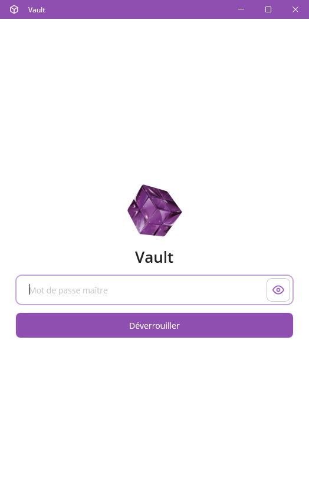
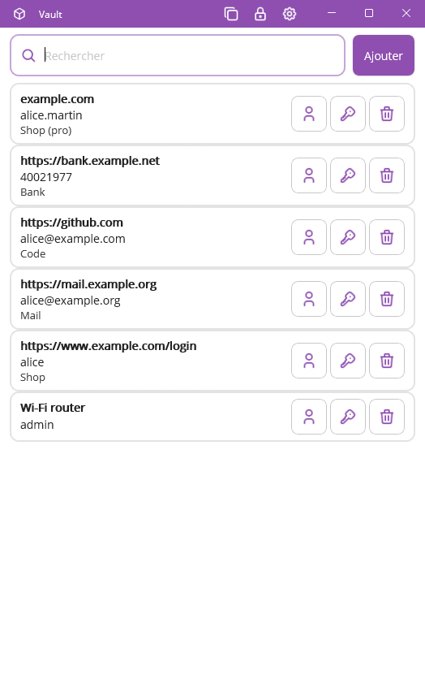
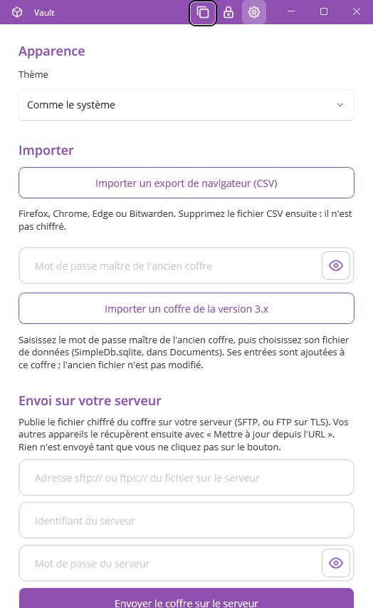
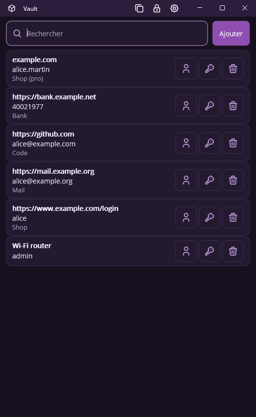
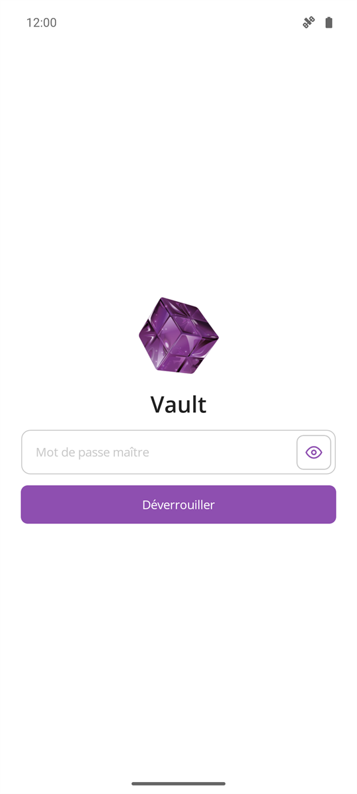
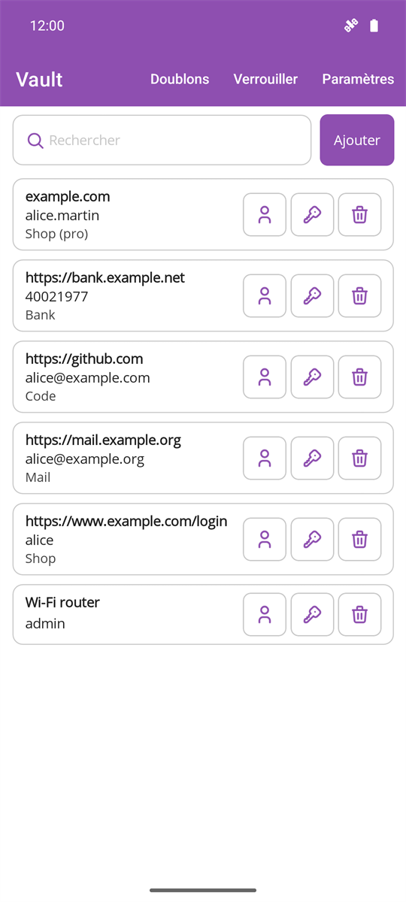
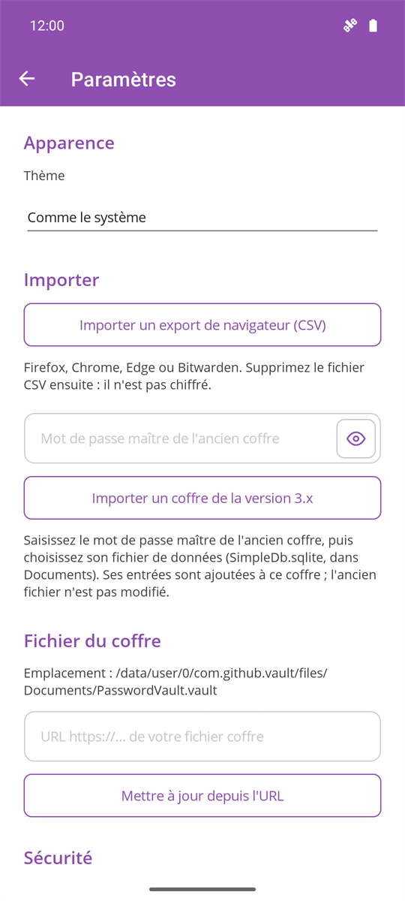
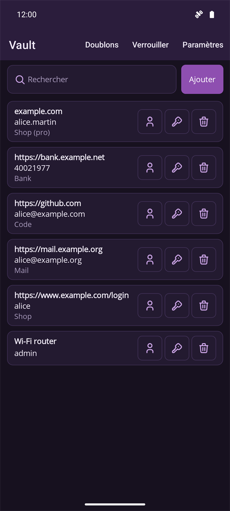

# Vault :ice_cube:
Coffre-fort de mots de passe avec import des mots de passe du navigateur. Ce coffre-fort utilise un chiffrement AES.

* Chiffrement AES-256-GCM, clé dérivée du mot de passe maître par PBKDF2-HMAC-SHA256 (600 000 itérations, sel aléatoire) :key:
* Importer vos mots de passe depuis Firefox, Chrome, Edge ou Bitwarden (CSV), ou depuis un coffre de la version 3.x :earth_americas:
* Recherche des entrées en double ou similaires
* Thèmes clair et sombre
* Support multilingue (:clipperton_island:, :us:)
* Compatible Android et Windows

# Application (v4.0+)

Une seule application .NET MAUI (`VaultGui`) pour **Windows et Android** : créer/déverrouiller le coffre,
rechercher, ajouter/modifier/supprimer des entrées, copier avec effacement automatique du presse-papiers (30 s, exclu
de l'historique du presse-papiers Windows, marqué sensible sur Android 13+), import CSV (Firefox, Chrome, Edge,
Bitwarden), import d'un coffre 3.x, recherche de doublons, thème clair/sombre, verrouillage automatique en
arrière-plan, changement du mot de passe maître, envoi du fichier coffre sur votre serveur (Windows) ou mise à jour
depuis une URL HTTPS.

# Nouveautés

- **En-tête (Windows) :** plus de bandeau. La barre de titre porte les actions sous forme d'icônes : *Envoyer* et
  *Mettre à jour* (si configurés), *Doublons*, *Verrouiller*, *Paramètres*. Elles restent accessibles sur toutes les
  pages ; *Paramètres* se referme d'un second clic. *Ajouter* est un bouton à côté du champ de recherche.
  Android conserve sa barre classique.
- **Liste :** chaque entrée a trois icônes au trait : copier l'identifiant, copier le mot de passe, supprimer
  (avec confirmation).
- **Doublons :** l'action *Doublons* n'affiche que les entrées qui partagent leur site avec une autre, côte à côte.
  Les adresses sont d'abord simplifiées : `https://www.example.com/login` et `example.com` sont le même site.
- **Thème sombre :** Paramètres > *Apparence* > *Thème* : comme le système (par défaut), clair ou sombre.
- **Import d'un coffre 3.x :** Paramètres > *Importer* : saisissez le mot de passe maître de l'ancien coffre, puis
  choisissez son fichier de données (`SimpleDb.sqlite`). Ses entrées sont ajoutées au coffre ouvert ; l'ancien
  fichier n'est pas modifié.
- **Supprimé :** *Partager le fichier coffre* et *Remplacer par un fichier coffre* (utilisez *Envoi sur votre serveur*
  et *Mettre à jour depuis l'URL*).

# Le PC comme poste principal, le téléphone télécharge (v4.0+)

1. **Windows :** travaillez comme d'habitude (recherche, ajout, modification, suppression).
2. **Envoi sur votre serveur :** Paramètres > *Envoi sur votre serveur* : adresse du fichier
   (`sftp://serveur/dossier/my.vault`, ou `ftps://…` pour du FTP sur TLS), identifiant, mot de passe, puis
   *Envoyer le coffre sur le serveur*. Ensuite l'écran principal propose un bouton *Envoyer* et rappelle quand des
   modifications n'ont pas encore été envoyées. Rien n'est envoyé automatiquement.
3. **Android (ou un autre PC) :** au premier lancement, saisissez l'adresse https de ce fichier sous *Vous avez déjà un
   coffre ?*, puis déverrouillez avec le même mot de passe maître. L'adresse est mémorisée : l'écran principal propose
   ensuite un bouton *Mettre à jour* qui récupère le dernier fichier en un geste. Il ne demande confirmation que si
   cet appareil a ses propres modifications, puisqu'elles seraient remplacées.

Sécurité du transfert :

- Le fichier est déjà chiffré ; la connexion l'est aussi. Le FTP non chiffré est refusé : l'identifiant ne circule jamais en clair.
- La première fois, l'application affiche l'empreinte du serveur (clé SSH, ou certificat TLS si Windows ne le reconnaît pas)
  et demande s'il faut lui faire confiance. Si elle change ensuite, l'application avertit et n'envoie rien sans votre accord.
- Le mot de passe du serveur est stocké chiffré pour votre compte Windows, jamais en clair.
- Le fichier est envoyé sous un nom temporaire puis échangé : un téléchargement ne récupère jamais un demi-fichier.
- *Supprimer le fichier du serveur* (Paramètres) le retire une fois vos appareils à jour ; les réglages du serveur
  sont conservés, *Envoyer* le republie au besoin.

# Déverrouillage rapide (v4.0+)

Paramètres > *Déverrouiller avec l'empreinte* (Android 10+) ou *Déverrouiller avec Windows Hello* (Windows).
Le mot de passe maître n'est jamais stocké : seule la clé dérivée du coffre, protégée par la plateforme.

- **Windows :** la clé du coffre est chiffrée avec une clé dérivée d'une signature Windows Hello (empreinte, visage ou
  code PIN Hello ; clé privée dans le TPM s'il y en a un). Rien de ce qui permet de déchiffrer n'est stocké : chaque
  déverrouillage demande une nouvelle validation Hello. La clé est perdue si Windows Hello est réinitialisé.
- **Android :** la clé du coffre est chiffrée avec une clé du Keystore Android utilisable uniquement après une
  authentification biométrique forte, et détruite si une nouvelle empreinte ou un nouveau visage est enregistré.
- Le déverrouillage rapide se désactive quand le mot de passe maître change : le mot de passe est redemandé.

# Format du coffre (v4.0+)

Le coffre tient dans un seul fichier, `my.vault` (dans Documents) : un petit en-tête JSON
(format, paramètres de dérivation, nonce) et les entrées chiffrées. L'en-tête est authentifié : toute
modification du fichier est détectée.

Un coffre de la version 3.x peut être ajouté à un coffre existant :
Paramètres > *Importer* > *Importer un coffre de la version 3.x* (seuls `SimpleDb.sqlite` et son mot de passe maître
sont nécessaires). Si vous publiez le coffre pour le bouton *Mettre à jour* de l'application
Android, publiez le fichier `my.vault` (URL HTTPS uniquement).

# L'application en détails

Windows :

Android :

# Installation et publication (v4.0+)

- **Windows 10 (1809+) / 11 :** lancez `Vault-<version>-win-x64-setup.exe` (pas besoin d'installer .NET).- **Android 8+ :** installez `Vault-<version>-android.apk` (autorisez l'installation depuis cette source).
  Les mises à jour doivent être signées avec la même clé : conservez précieusement le keystore de publication.

Publier une version :

1. Une fois : `scripts/new-android-keystore.ps1` crée la clé de signature Android (hors du dépôt). Sauvegardez-la.
2. En local : `scripts/publish-windows.ps1 -Version x.y.z` (installeur si Inno Setup 6 est installé) et
   `scripts/publish-android.ps1 -Version x.y.z` (nécessite `ANDROID_KEYSTORE`, `ANDROID_KEYSTORE_PASSWORD`,
   `ANDROID_KEY_PASSWORD`). Résultat dans `out/`.
3. Ou sur GitHub : ajoutez les secrets listés dans `.github/workflows/release.yml` et poussez un tag `vx.y.z` :
   le workflow teste, compile, signe et crée une publication **brouillon** avec l'installeur, l'APK, l'AAB et les sommes de contrôle.

La version vient de `Version` dans `Directory.Build.props` (ou du tag) ; le code de version Android vaut
`majeur*10000 + mineur*100 + correctif`.

# Remerciements  :pray:
> [NLog](https://github.com/NLog)

> [CsvHelper](https://github.com/JoshClose/CsvHelper)
