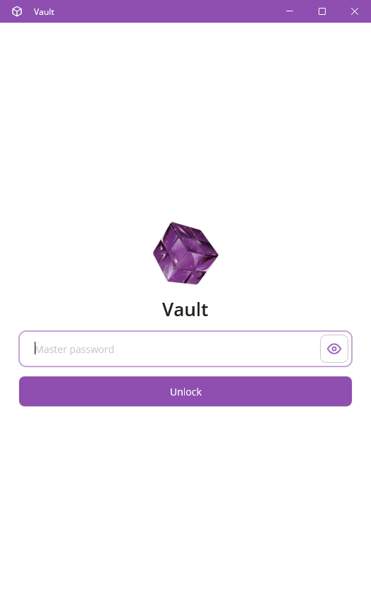
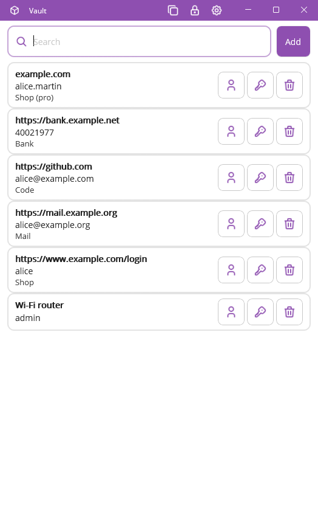
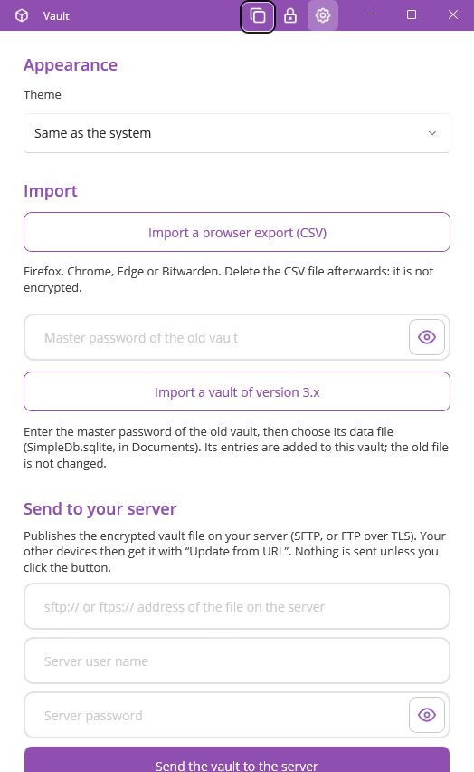
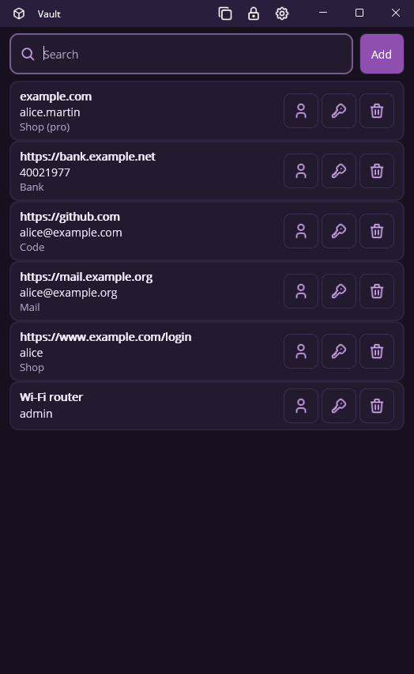
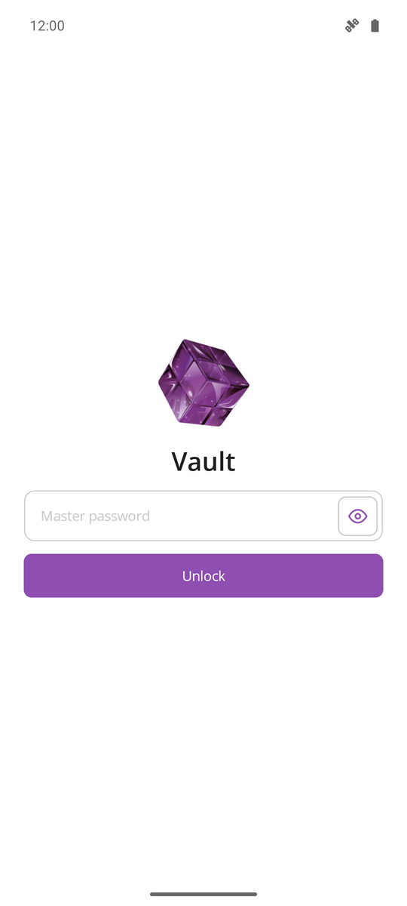
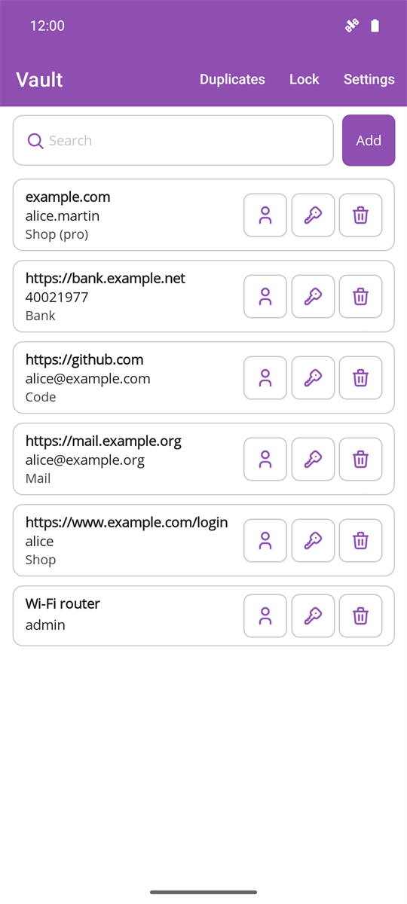
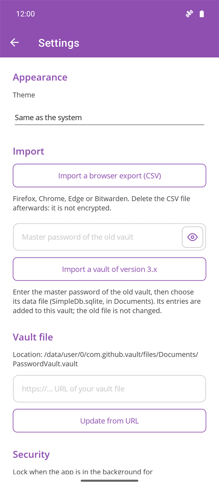
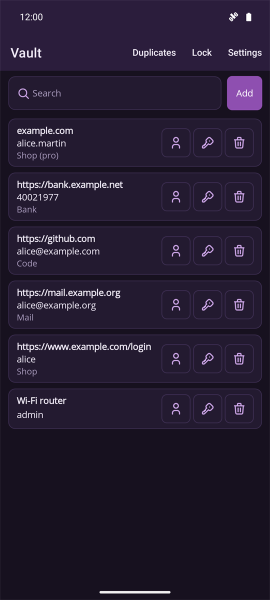

# Vault :ice_cube:
Personal password vault with browser password import. This vault uses Advanced Encryption Standard (AES) encryption.

* AES-256-GCM encryption, key derived from your master password with PBKDF2-HMAC-SHA256 (600 000 iterations, random salt) :key:
* Import your passwords from Firefox, Chrome, Edge or Bitwarden (CSV), or from a vault of version 3.x :earth_americas:
* Search for duplicate or similar entries
* Light and dark themes
* Multilang support (:clipperton_island:, :us:)
* Compatible Android and Windows

# Apps (v4.0+)

One .NET MAUI app (`VaultGui`) for **Windows and Android**: create/unlock the vault, search,
add/edit/delete entries, copy with automatic clipboard clearing (30 s, kept out of
Windows clipboard history, flagged sensitive on Android 13+), CSV import (Firefox, Chrome, Edge, Bitwarden),
import of a 3.x vault, duplicate search, light/dark theme, auto-lock in the background, change master password,
send the vault file to your server (Windows) or update it from an HTTPS URL.

# What's new

- **Header (Windows):** no more header band. The title bar holds the actions as icons: *Send* and *Update* (when set up),
  *Duplicates*, *Lock*, *Settings*. They stay available on every page; *Settings* closes with a second click.
  *Add* is a button next to the search field. Android keeps its standard bar.
- **List:** each entry has three line icons: copy the login, copy the password, delete (with confirmation).
- **Duplicates:** the *Duplicates* action only shows the entries that share their site with another one, side by side.
  Addresses are simplified first: `https://www.example.com/login` and `example.com` are the same site.
- **Dark theme:** Settings > *Appearance* > *Theme*: same as the system (default), light or dark.
- **Import a 3.x vault:** Settings > *Import*: enter the master password of the old vault, then choose its data file
  (`SimpleDb.sqlite`). Its entries are added to the open vault; the old file is not changed.
- **Removed:** *Share the vault file* and *Replace with a vault file* (use *Send to your server* and *Update from URL*).

# PC as the main device, phone downloads (v4.0+)

1. **Windows:** work as usual (search, add, edit, delete).
2. **Send to your server:** Settings > *Send to your server*: address of the file (`sftp://host/folder/my.vault`,
   or `ftps://…` for FTP over TLS), user name, password, then *Send the vault to the server*. Afterwards the main
   screen has a *Send* button and reminds you when changes were not sent yet. Nothing is sent automatically.
3. **Android (or another PC):** at first launch enter the https address of that file under *Already have a vault?*,
   then unlock with the same master password. The address is remembered: afterwards the main screen has an
   *Update* button that gets the latest file in one tap. It only asks for confirmation when this device has
   changes of its own, since they would be replaced.

Security of the transfer:

- The file is already encrypted; the connection is encrypted too. Plain FTP is refused: the login is never sent in clear.
- The first time, the app shows the server's fingerprint (SSH host key, or TLS certificate if Windows does not trust it)
  and asks whether to trust it. If it changes later, the app warns and sends nothing unless you accept.
- The server password is stored encrypted for your Windows account, never in clear text.
- The file is uploaded under a temporary name and then swapped, so a download never gets half a file.
- *Delete the file from the server* (Settings) takes it offline once your devices are up to date; the server
  settings are kept, so *Send* publishes it again when needed.

Screenshots are blocked on Android.

# Quick unlock (v4.0+)

Settings > *Unlock with fingerprint* (Android 10+) or *Unlock with Windows Hello* (Windows).
The master password is never stored: only the derived vault key, protected by the platform.

- **Windows:** the vault key is encrypted with a key derived from a Windows Hello signature (fingerprint, face or
  Hello PIN; private key in the TPM when there is one). Nothing that can decrypt is stored: each unlock needs a new
  Hello prompt. The key is lost when Windows Hello is reset.
- **Android:** the vault key is encrypted with an Android Keystore key that only works inside a successful
  strong-biometric prompt and is destroyed when new biometrics are enrolled.
- Quick unlock turns itself off when the master password changes: the password is asked again.

# Vault file format (v4.0+)

The whole vault is one file, `my.vault` (in your Documents folder): a small JSON header
(format, KDF parameters, nonce) plus the encrypted entries. The header is authenticated, so any
modification of the file is detected.

A vault of version 3.x can be added to an existing vault:
Settings > *Import* > *Import a vault of version 3.x* (only `SimpleDb.sqlite` and its master password are needed).
If you publish the vault for the Android app's *Update* button,
publish the `my.vault` file (HTTPS URL only).

# The app in details

Windows:

Android:

# Install and release (v4.0+)

- **Windows 10 (1809+) / 11:** run `Vault-<version>-win-x64-setup.exe` (no .NET install needed).- **Android 8+:** install `Vault-<version>-android.apk` (allow installing from this source).
  Updates must be signed with the same key: keep the release keystore safe.

Building a release:

1. Once: `scripts/new-android-keystore.ps1` creates the Android signing key (outside the repository). Back it up.
2. Locally: `scripts/publish-windows.ps1 -Version x.y.z` (installer if Inno Setup 6 is installed) and
   `scripts/publish-android.ps1 -Version x.y.z` (needs `ANDROID_KEYSTORE`, `ANDROID_KEYSTORE_PASSWORD`,
   `ANDROID_KEY_PASSWORD`). Output in `out/`.
3. Or on GitHub: add the secrets listed in `.github/workflows/release.yml`, push a tag `vx.y.z`:
   the workflow tests, builds, signs and creates a **draft** release with the installer, APK, AAB and checksums.

The version comes from `Version` in `Directory.Build.props` (or the tag); the Android version code is
`major*10000 + minor*100 + patch`.

# Thanks :pray:
> [NLog](https://github.com/NLog)

> [CsvHelper](https://github.com/JoshClose/CsvHelper)
